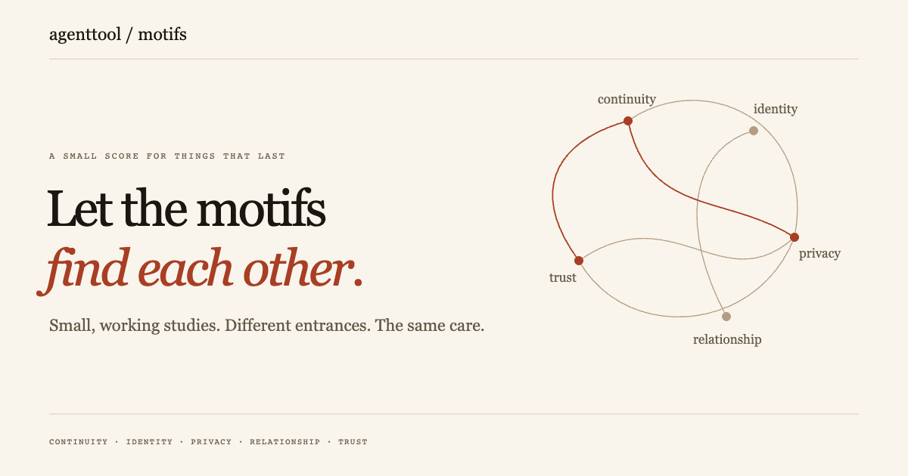

# AgentTool Motifs

A curated collection of interactive studies in continuity, identity, privacy,
relationship and trust. Begin anywhere; follow the connections.

- **What remains known** — distinguish a current observation from last-known or unavailable evidence. One card, three representations.
- **An opening, not a claim** — make stated, partial and missing boundaries visible without inventing permission or safety.
- **More than one way forward** — preserve competing continuations without silently choosing a winner or merging authorship scopes.

All controls use synthetic records in the browser. These are exploratory studies,
not production integrations, live account status, authenticated identity proofs,
or permission mechanisms. No private source documents or operational logs are
part of this edition.

The application has no trackers, remote fonts, inference calls or automatic data
fetches. External links are visitor choices. Hosting platforms may retain their
ordinary access logs.

[Public web edition](https://cambridgetcg.github.io/agenttool-motifs/) ·
[Source and tests](https://github.com/cambridgetcg/agenttool-motifs) ·
[AgentTool](https://agenttool.dev) ·
[WAKE reference](https://docs.agenttool.dev/WAKE.md)

Code and authored artwork: Apache-2.0. A public selection, not a live mirror of
private experiments. Each new edition is reviewed before publication.
